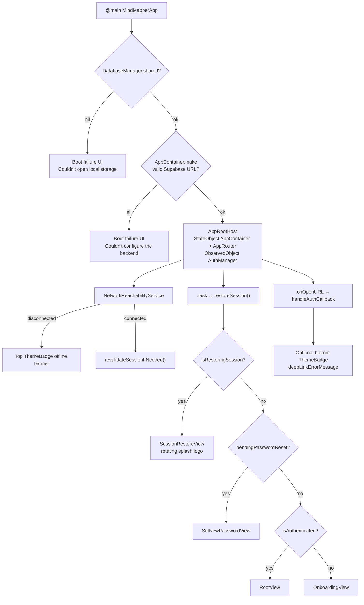
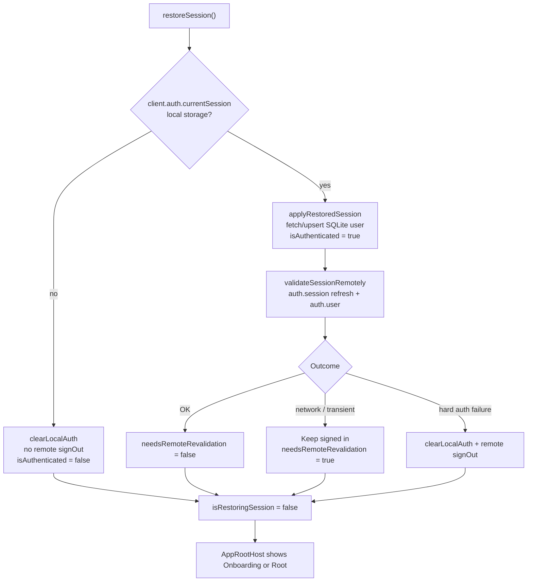
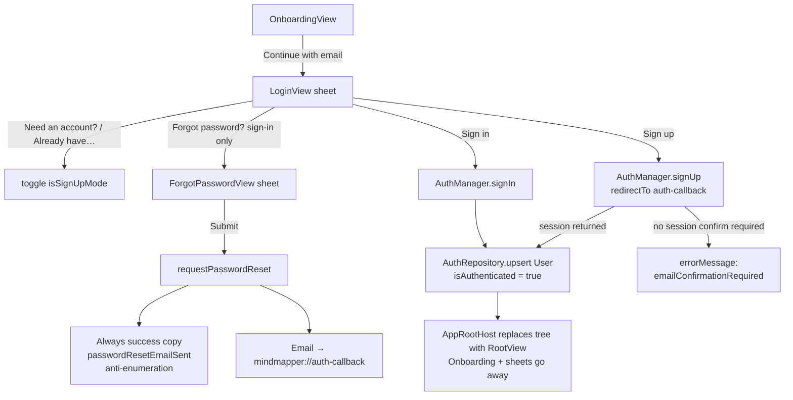
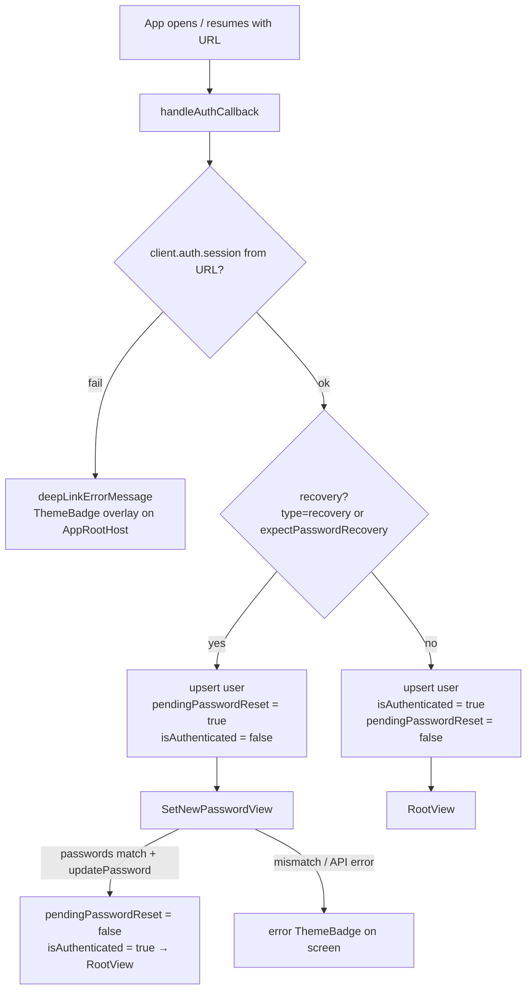
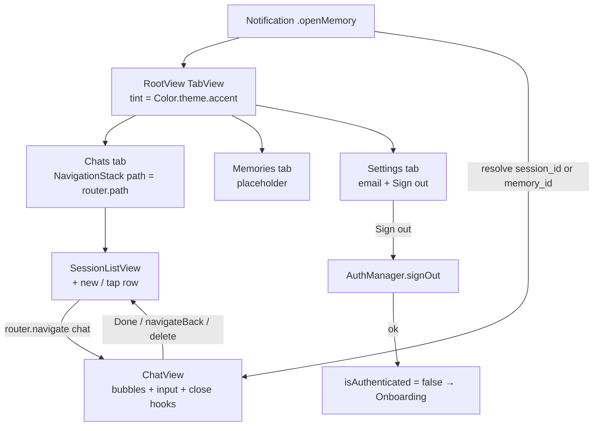
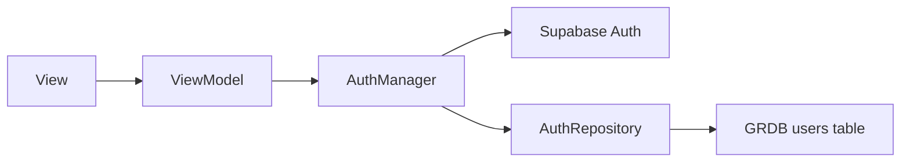

# Mind Mapper — Current App Flow

> **Living document.** Describes only what is **built and wired into the running app today**.  
> **After every task that changes screens, routing, or auth behavior, update this file** in the same PR / same session (diagrams + screen map + “built / not yet” lists).

Related: [`theme-guide.md`](theme-guide.md) (visual system), `iOSApp/AGENT.md` (architecture rules).

Primary flow code:

- `App/MindMapperApp.swift` (`MindMapperApp` + `AppRootHost`)
- `Core/Navigation/AppRouter.swift`
- `Core/Network/AuthManager.swift` / `AuthManagerProtocol.swift`
- `Core/DI/AppContainer.swift`
- `Features/Onboarding|Auth|Root|Sessions|Chat|Memories|Settings/*`

---

## Built so far (in the live app)

| Area | What exists |
|------|-------------|
| Boot | System `LaunchScreen` (blue + centered “Mind Mapper”) → `DatabaseManager` → `AppContainer` → `AppRootHost` / `SessionRestoreView`, or boot-failure text |
| Theme | Color/font/spacing tokens + shared components (`PrimaryButton`, `ThemeTextField`, `ThemeBadge`, …) |
| Local DB | GRDB `memory.db`, V1 schema (`users`, `sessions`, `messages`, `memories`, …) |
| Auth | Email sign up / sign in / sign out, session restore, forgot password, set new password, deep-link callback |
| Reachability | Single `NetworkReachabilityService` (`NWPathMonitor`), global offline banner, `NetworkGate` + auth VM guards |
| Reconnect | On path → connected, `revalidateSessionIfNeeded()` |
| Local user | On auth success, upsert `users` via `AuthRepository` |
| Screens in flow | Onboarding, Login (sheet), Forgot password (sheet), Set new password, Root tabs (Chats / Memories / Settings), Session list shell, Chat shell, session restore splash, boot failure, offline banner |
| Navigation | `AppRouter` (`path`, sheets, `selectedTab`, `.openMemory` deep link) as `@EnvironmentObject` |
| Config | `AppConfig` (Supabase URL/key, `mindmapper://auth-callback`) |

---

## 1. Cold start → root gate

Auth sheets call `NetworkGate.requireConnection` before Supabase; offline attempts show `AppError.noInternet` inline (banner remains the global signal).

Gate priority in `AppRootHost` (first match wins):

1. `isRestoringSession` → spinner  
2. `pendingPasswordReset` → set new password  
3. `isAuthenticated` → Root  
4. else → Onboarding  

`isRestoringSession` defaults to `true` until `restoreSession()` finishes (including remote validation), so cold start shows `SessionRestoreView` (branded splash) briefly — longer if the network is slow.

---

## 2. Session restore (local-first) — task 07b

Classifier: `AuthNetworkErrorClassifier` (transient vs hard auth).  
`revalidateSessionIfNeeded()` exists on the protocol but is **not** called from UI yet (task 07d).

---

## 3. Unauthenticated path

Notes:

- Login / Forgot password are **sheets** on Onboarding. Authenticated navigation uses `AppRouter` (tabs + Chats `NavigationStack`).
- Login does not call `dismiss()` on success — the host swaps to `RootView`, so Onboarding (and its sheet) leave the hierarchy.
- Errors surface as `ThemeBadge` via `AppError` on the ViewModel.

---

## 4. Deep links (`mindmapper://auth-callback`)

Registered URL scheme + `AppConfig.authCallbackURLString`. Same handler for **confirm email** and **password recovery**.

---

## 5. Signed-in path (today)

`RootView` is the authenticated shell. Session list (task 17) and chat UI (task 18) are shipped. Sign-out lives on Settings.

---

## 6. Auth call shape (every auth screen)

ViewModels never talk to Supabase or GRDB directly. Factories live on `AppContainer` (`makeLoginViewModel()`, etc.).

---

## Screen map (current)

| Surface | Entry | Exit / next |
|--------|--------|-------------|
| Boot failure text | DB or config missing | — |
| `SessionRestoreView` (rotating logo) | `isRestoringSession` | Onboarding / Root / SetNewPassword |
| `OnboardingView` | Signed out, not resetting password | Sheet → Login |
| `LoginView` | Onboarding sheet | Sign-in/up → Root; or sheet → Forgot password |
| `ForgotPasswordView` | Login sheet | Success message; email deep link later |
| `SetNewPasswordView` | Recovery deep link | Update password → Root |
| `RootView` (tabs) | `isAuthenticated` | Chats / Memories / Settings; sign out → Onboarding |
| `SessionListView` | Chats tab root | + or row → `ChatView` via `AppRouter` |
| `ChatView` | `Destination.chat` | Menu memories/delete; disappear/background → `closeSession` |
| `MemoryListView` (placeholder) | Memories tab or push | — |
| `SettingsView` | Settings tab | Sign out / delete account → Onboarding |
| Deep-link error badge | Failed `handleAuthCallback` | Tap to clear |
| Offline banner (top) | `networkReachability.status == .disconnected` | Auto-hides when connected |

---

## Present in the project but **not** in the live flow

| Item | Status |
|------|--------|
| `ContentView` | Xcode template leftover — not used by `@main` |
| Memories list / memory detail content | Placeholders |
| Push notification → `.openMemory` poster | Observer ready; delegate in task 20 |
| Sign in with Apple | Pre-release checklist |

---

## Maintenance checklist (when a task changes flow)

- [ ] Update the relevant Mermaid diagram(s)
- [ ] Update **Screen map** and **Built so far**
- [ ] Move items out of **not in the live flow** when they ship
- [ ] Keep this file scoped to **runtime user flow**, not every class in the repo
