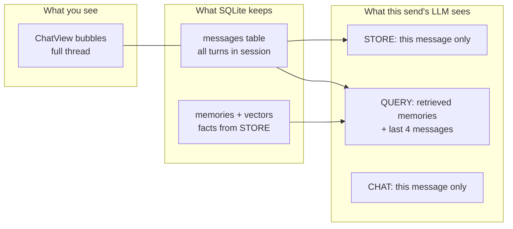

# Chat Sessions: Does the LLM See Previous Messages?

How a **single chat session** works in Mind Mapper — what the UI remembers vs what each LLM call actually receives — using your passport example.

**Related code:** `Features/Chat/ChatView.swift`, `Features/Chat/ChatViewModel.swift`, `Domain/UseCases/SaveMemoryUseCase.swift`, `Core/RAG/RAGAnswerService.swift`, `Domain/UseCases/CloseSessionUseCase.swift`  
**Related tasks:** [`14`](../tasks/phase_1/14-mixed-query-chat_iOS.md) (orchestrator), [`15`](../tasks/phase_1/15-session-close-pipeline_iOS.md) (close / transcript), [`18`](../tasks/phase_1/18-chat-ui_iOS.md) (UI)  
**Related:** [`rag-how-it-works.md`](./rag-how-it-works.md), [`app-flow.md`](../design/app-flow.md)

---

## Direct answer to your example

```text
1st: "I kept my passport in 3rd drawer of wardrobe"
     → LLM ack: "Acknowledged" (STORE)

2nd: "The passport is inside a blue colored file."
```

**For the 2nd message STORE call: no — the extraction / ack LLM does not get message 1 in its prompt.**  
It only sees the current string: *“The passport is inside a blue colored file.”*

What *does* happen:

| Layer | After message 1 | When you send message 2 |
|---|---|---|
| **UI** (`ChatView`) | Shows both bubbles once saved | You still see the full thread |
| **SQLite `messages`** | User + assistant rows for turn 1 | Turn 2 appended to the **same** `sessionId` |
| **SQLite `memories` + vectors** | Fact about drawer embedded | New fact about blue file embedded (separate memory, unless supersede kicks in) |
| **STORE LLM prompts** | Only message 1 text | Only message 2 text — **no chat history** |

So the model is **not** chatting with a rolling transcript on STORE. Continuity comes from **saved memories** (and later RAG / session close), not from “remembering the previous LLM turn.”

---

## The short mental model

Think of three different “memories”:

1. **Screen history** — `viewModel.messages` for the human. Loaded from SQLite; grows every send.
2. **Per-turn LLM context** — usually **only the current user text** (STORE / CHAT). QUERY/MIXED add retrieved memories + **last 4** session messages.
3. **Long-term personal memory** — `memories` + `vectors` (and summary bullets on session close). This is what answers “Where is my passport?” later.



---

## What a session is in this app

One **chat session** = one `sessionId` row + all `messages` with that id.

- Open chat → `.task { await viewModel.loadSession() }` reloads history from DB.
- Send → save user message → classify intent → route → save assistant reply.
- Leave / background / 2 min idle → `closeSession()` may title + summarise the **full transcript** (task 15).

```60:62:iOSApp/MindMapper/MindMapper/Features/Chat/ChatView.swift
        .task {
            await viewModel.loadSession()
        }
```

```90:98:iOSApp/MindMapper/MindMapper/Features/Chat/ChatViewModel.swift
    func loadSession() async {
        errorMessage = nil
        isEditingFailedTurn = false
        do {
            if let session = try await dependencies.sessionRepository.fetch(id: sessionId) {
                currentSession = session
            }
            let stored = try await dependencies.messageRepository.fetchAll(for: sessionId)
            messages = stored.map { MessageDisplayModel(from: $0) }
```

The list in `ChatView` only **renders** `viewModel.messages`. It does not pass that array into the LLM.

---

## What happens on each send

```258:272:iOSApp/MindMapper/MindMapper/Features/Chat/ChatViewModel.swift
        let userMessage = Message(sessionId: sessionId, role: "user", content: raw)
        do {
            try await dependencies.messageRepository.save(userMessage)
            guard isPipelineActive(generation) else { return }
            messages.append(MessageDisplayModel(from: userMessage))
            markActivityForSessionClose()
        } catch {
            // ...
        }

        await runPipeline(sanitised: sanitised, generation: generation)
```

Pipeline: scope guard → `ClassifyIntentUseCase` → `route(intent:text:)` with **that turn’s** `sanitised` string only.

```449:488:iOSApp/MindMapper/MindMapper/Features/Chat/ChatViewModel.swift
    private func route(intent: Intent, text: String) async throws -> String {
        switch intent {
        case .store:
            return try await dependencies.saveMemoryUseCase.execute(
                text: text,
                sessionId: sessionId,
                userId: userId
            )
        case .query:
            let answer = try await dependencies.queryMemoryUseCase.execute(
                question: text,
                sessionId: sessionId,
                userId: userId
            )
            // ...
        case .chat:
            return try await dependencies.llmClient.complete(
                tier: .mini,
                messages: [
                    LLMMessage(
                        role: "system",
                        content: """
                            You are a friendly personal memory assistant. Keep casual replies brief.
                            """
                    ),
                    LLMMessage(role: "user", content: text),
                ],
                // ...
            )
        }
    }
```

Note: `messages:` here is the **LLM API payload**, not `viewModel.messages`. For CHAT it is system + current user text only.

---

## Intent by intent: does prior chat go to the LLM?

### STORE (your example)

`SaveMemoryUseCase` gets `text` = current message.

- **Extract** LLM → only that text → `clean_text` / entities / optional `supersedes_hint`
- **Ack** LLM → only that text again

```26:29:iOSApp/MindMapper/MindMapper/Domain/UseCases/SaveMemoryUseCase.swift
    func execute(text: String, sessionId: String, userId: String) async throws -> String {
        let extraction = try await memoryExtractor.extract(from: text)
        let supersedesId = try await resolveSupersedesId(hint: extraction.supersedesHint)
        let embedding = try await llmClient.embed(text: extraction.cleanText, tier: .embed)
```

So on message 2:

- Extraction does **not** see “3rd drawer of wardrobe.”
- It will try to turn “The passport is inside a blue colored file.” into its **own** standalone fact.
- `sessionId` is used to **tag** the new memory row to this chat, not to load prior turns into the prompt.
- Supersede only runs if the extractor returns a `supersedes_hint` (e.g. “instead of…”) and vector search finds an older memory. Your second line may or may not trigger that — it often becomes a **second** memory about the same passport.

**Implication:** After both STOREs, the library might hold:

1. Passport in 3rd drawer  
2. Passport inside a blue file  

A later QUERY can retrieve **both** via RAG and synthesise (“drawer… and in a blue file”). That is memory search, not “the ack model recalled turn 1.”

### QUERY / MIXED

Here prior context **is** partially injected:

1. **Retrieved memories** (any session, via vectors/entities) — so turn 1’s saved fact can appear even if it is not in the last-4 window.
2. **Last 4 messages** of the **current** session from SQLite.

```48:54:iOSApp/MindMapper/MindMapper/Core/RAG/RAGAnswerService.swift
        let resolved = RAGRetriever.resolveTemporalOrder(confident)
        let recentMessages = try await loadRecentMessages(sessionId: sessionId)
        let text = try await synthesise(
            question: question,
            memories: resolved,
            recentMessages: recentMessages
        )
```

```81:91:iOSApp/MindMapper/MindMapper/Core/RAG/RAGAnswerService.swift
    private func loadRecentMessages(sessionId: String) async throws -> [Message] {
        do {
            return try await database.dbQueue.read { db in
                try MessageRecord
                    .filter(Column("session_id") == sessionId)
                    .order(Column("created_at").desc)
                    .limit(4)
                    .fetchAll(db)
                    .reversed()
                    .map(\.domainModel)
```

Those 4 include the user question just saved (and recent acks). They are **short chat glue**, not a full transcript. Grounding still comes mainly from retrieved `memories`.

MIXED reuses the same RAG answer path, then merges with general knowledge ([`rag-how-it-works.md`](./rag-how-it-works.md)).

### CHAT

Casual reply: **current message only**. No history, no RAG.

---

## Walkthrough of your two turns

```text
Turn 1 — STORE
  UI:     append user bubble
  DB:     messages += user
  LLM:    extract("I kept my passport in 3rd drawer…")  ← only this
  DB:     memories += "Passport is in the 3rd drawer of the wardrobe" + vector
  LLM:    ack(same text)  ← only this
  DB:     messages += assistant

Turn 2 — STORE (same sessionId)
  UI:     still shows turn 1 + new user bubble
  DB:     messages += user (full thread in SQLite)
  LLM:    extract("The passport is inside a blue colored file.")  ← NOT turn 1
  DB:     memories += new fact (+ maybe supersede if hinted)
  LLM:    ack(message 2 only)
```

If turn 2 were instead **“Where is my passport?”** (QUERY):

- Vector/entity search can find the drawer memory from turn 1.
- Last-4 messages can include the earlier STORE + ack.
- Synthesis LLM then answers from **retrieved memories** (+ those recent lines), not from a hidden full-session prompt.

---

## When the **full** session transcript is used

Not on every send. On **session close** (leave chat, background, or ~2 minutes idle):

```63:66:iOSApp/MindMapper/MindMapper/Features/Chat/ChatView.swift
        .onDisappear {
            Task {
                await viewModel.onLeaveChat()
            }
        }
```

`CloseSessionUseCase` loads **all** messages for that `sessionId`, builds a transcript, generates title / topic / summary bullets, and embeds each bullet as extra memories. That is how multi-turn chatter becomes searchable later — after close, not during each STORE ack.

---

## Common misconceptions

| Belief | Reality in this codebase |
|---|---|
| “Same chat = LLM always has full history” | **False** for STORE/CHAT. True only in a limited way for QUERY/MIXED (last 4 + RAG). |
| “I see both bubbles, so the model saw them” | UI history ≠ LLM context. |
| “Second STORE updates the first memory automatically” | Only if extraction yields a supersede hint and vector lookup finds the old row. |
| “Nothing remembers turn 1” | Turn 1 is in `messages` (UI/close) and usually in `memories`/`vectors` (RAG). |

---

## Practical takeaways

1. **Writing facts:** each STORE is mostly **standalone**. Prefer one clear sentence per fact, or language that triggers supersede when you mean “replace the old location.”
2. **Asking later:** QUERY uses the **memory index**, so earlier STOREs in this (or other) sessions can still be found even though STORE never sent history.
3. **Same-session follow-ups that are questions** get last-4 chat lines as extra context; still rely on RAG for the real facts.
4. **Leaving the chat** folds the whole thread into title/summary embeddings for future retrieval.

---

## File map

| Concern | File |
|---|---|
| Bubbles + load/leave hooks | `Features/Chat/ChatView.swift` |
| Send pipeline + intent route | `Features/Chat/ChatViewModel.swift` |
| STORE without history | `Domain/UseCases/SaveMemoryUseCase.swift` |
| QUERY last-4 + memories | `Core/RAG/RAGAnswerService.swift` |
| Full transcript on close | `Domain/UseCases/CloseSessionUseCase.swift` |
