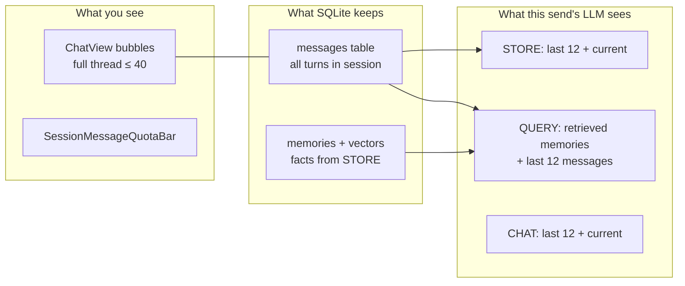

# Chat Sessions: Does the LLM See Previous Messages?

How a **single chat session** works in Mind Mapper — what the UI remembers vs what each LLM call actually receives — using your passport example.

**Related code:** `Features/Chat/ChatView.swift`, `Features/Chat/ChatViewModel.swift`, `Core/Chat/ChatLimits.swift`, `Domain/UseCases/SaveMemoryUseCase.swift`, `Core/RAG/RAGAnswerService.swift`, `Domain/UseCases/CloseSessionUseCase.swift`  
**Related tasks:** [`14`](../tasks/phase_1/14-mixed-query-chat_iOS.md), [`15`](../tasks/phase_1/15-session-close-pipeline_iOS.md), [`18`](../tasks/phase_1/18-chat-ui_iOS.md), [`19c`](../tasks/phase_1/19c-chat-rolling-transcript_iOS.md) (**shipped** rolling transcript + session cap)  
**Related:** [`rag-how-it-works.md`](./rag-how-it-works.md), [`app-flow.md`](../design/app-flow.md)

---

## As shipped (task 19c)

ChatGPT-style **rolling transcript**: last **12** messages (`ChatLimits.rollingContextMessageCount`) go into STORE extract/ack, CHAT, intent classify (tail of 4), and QUERY recent-chat. Hard cap **40** messages per session (block send when full). Per-message **500** characters unchanged. UI shows `SessionMessageQuotaBar` above the input (green → red as the chat fills).

---

## Direct answer to your example

```text
1st: "I kept my passport in 3rd drawer of wardrobe"
     → LLM ack: "Acknowledged" (STORE)

2nd: "The passport is inside a blue colored file." / "It is inside a blue colored file."
```

**For the 2nd STORE call: yes — message 1 (and its ack) are included in the rolling `conversationContext`.**  
Extraction is instructed to resolve pronouns from prior turns and still emit **one** standalone `clean_text` for the **new** fact only.

| Layer | After message 1 | When you send message 2 |
|---|---|---|
| **UI** (`ChatView`) | Shows both bubbles once saved | Full thread + quota bar |
| **SQLite `messages`** | User + assistant rows for turn 1 | Turn 2 appended to the **same** `sessionId` |
| **SQLite `memories` + vectors** | Fact about drawer embedded | New fact about blue file (or supersede if hinted) |
| **STORE LLM prompts** | Rolling context (empty on first turn) + text | Prior turns + current text |

Long-term continuity still also uses **saved memories** / RAG / session close — rolling context is the short-term ChatGPT-style window (capped at 12).

---

## The short mental model

Think of three different “memories”:

1. **Screen history** — `viewModel.messages` for the human. Loaded from SQLite; grows every send (max **40**).
2. **Per-turn LLM context** — last **12** session messages (STORE / CHAT / QUERY glue) via `ChatLimits`. Intent uses a shorter tail of **4**.
3. **Long-term personal memory** — `memories` + `vectors` (and summary bullets on session close). This is what answers “Where is my passport?” across sessions.



---
## What a session is in this app

One **chat session** = one `sessionId` row + all `messages` with that id.

- Open chat → `.task { await viewModel.loadSession() }` reloads history from DB.
- Send → save user message → classify intent → route → save assistant reply.
- Leave / background / 2 min idle → `closeSession()` may title + summarise the **full transcript** (task 15).

```60:62:iOSApp/MindMapper/MindMapper/Features/Chat/ChatView.swift
        .task {
            await viewModel.loadSession()
        }
```

```90:98:iOSApp/MindMapper/MindMapper/Features/Chat/ChatViewModel.swift
    func loadSession() async {
        errorMessage = nil
        isEditingFailedTurn = false
        do {
            if let session = try await dependencies.sessionRepository.fetch(id: sessionId) {
                currentSession = session
            }
            let stored = try await dependencies.messageRepository.fetchAll(for: sessionId)
            messages = stored.map { MessageDisplayModel(from: $0) }
```

The list in `ChatView` **renders** `viewModel.messages`. On send, `ChatViewModel` builds a rolling LLM payload from that list via `ChatLimits` (it does not send the unbounded full UI array).

---

## What happens on each send

1. Guard session message cap (`ChatLimits.isAtMessageLimit`).
2. Save user message → append bubble.
3. Scope → classify (with short rolling tail) → `route` with rolling context for STORE/CHAT; QUERY/MIXED load recent messages inside RAG.

`route` builds `conversationContext` with `rollingLLMContext(limit:excludingCurrentText:)` before calling use cases / CHAT complete.

---

## Intent by intent: does prior chat go to the LLM?

### STORE (your example)

`SaveMemoryUseCase` gets `text` = current message **plus** `conversationContext` = rolling prior turns (excluding the current user row so it is not duplicated).

- **Extract** LLM → prior turns + current text → `clean_text` / entities / optional `supersedes_hint`
- **Ack** LLM → same context + current text

```26:36:iOSApp/MindMapper/MindMapper/Domain/UseCases/SaveMemoryUseCase.swift
    func execute(
        text: String,
        sessionId: String,
        userId: String,
        conversationContext: [LLMMessage] = []
    ) async throws -> String {
        let extraction = try await memoryExtractor.extract(
            from: text,
            conversationContext: conversationContext
        )
```

So on message 2:

- Extraction **can** see “3rd drawer of wardrobe” via rolling context and resolve “it” → passport.
- It still produces **one** standalone fact for the new turn.
- `sessionId` tags the memory to this chat.
- Supersede still runs when a `supersedes_hint` + vector hit exist.

### QUERY / MIXED

1. **Retrieved memories** (any session, via vectors/entities).
2. **Last 12 messages** of the **current** session (`ChatLimits.rollingContextMessageCount`).

### CHAT

System + rolling prior turns + current user text (no RAG).

---

## Walkthrough of your two turns

```text
Turn 1 — STORE
  UI:     append user bubble; quota bar ticks up
  DB:     messages += user
  LLM:    extract(text, context: [])  ← first turn
  DB:     memories += drawer fact + vector
  LLM:    ack(text, context: [])
  DB:     messages += assistant

Turn 2 — STORE (same sessionId)
  UI:     full thread + quota bar
  DB:     messages += user
  LLM:    extract(text, context: [turn1 user, turn1 ack])  ← rolling
  DB:     memories += blue-file fact (+ maybe supersede)
  LLM:    ack(text, context: […])
```

---

## When the **full** session transcript is used

Not on every send. On **session close** (leave chat, background, or ~2 minutes idle), `CloseSessionUseCase` still loads **all** messages for title / summary / summary embeddings.

Per-send rolling window never dumps the entire session (always ≤ 12). Session hard-stops at **40** messages — start a new chat when the quota bar is full.

---

## Common misconceptions

| Belief | Reality |
|---|---|
| “Same chat = entire history every LLM call” | **False** — last **12** only (`ChatLimits`). |
| “I see both bubbles, so the model saw them” | UI can show up to 40; LLM only gets the rolling window (+ RAG on QUERY). |
| “Second STORE updates the first memory automatically” | Only with supersede hint + vector hit; otherwise two memories. |
| “I can chat forever in one session” | Cap **40** messages; UI blocks send and shows session-full copy. |

---

## Practical takeaways

1. **Writing facts:** short follow-ups can rely on rolling context for pronouns; still prefer clear standalone sentences when possible.
2. **Asking later / other sessions:** QUERY uses the **memory index** (RAG), not only the last-12 chat lines.
3. **Quota bar:** watch remaining messages; start a new chat when full rather than expecting auto-split.
4. **Leaving the chat** still folds the whole thread into title/summary embeddings for future retrieval.

---

## File map

| Concern | File |
|---|---|
| Limits + rolling helpers | `Core/Chat/ChatLimits.swift` |
| Quota bar UI | `Core/Theme/Components/SessionMessageQuotaBar.swift` |
| Bubbles + load/leave + quota | `Features/Chat/ChatView.swift` |
| Send pipeline + intent route | `Features/Chat/ChatViewModel.swift` |
| STORE with context | `Domain/UseCases/SaveMemoryUseCase.swift`, `Core/RAG/MemoryExtractor.swift` |
| QUERY last-12 + memories | `Core/RAG/RAGAnswerService.swift` |
| Full transcript on close | `Domain/UseCases/CloseSessionUseCase.swift` |
