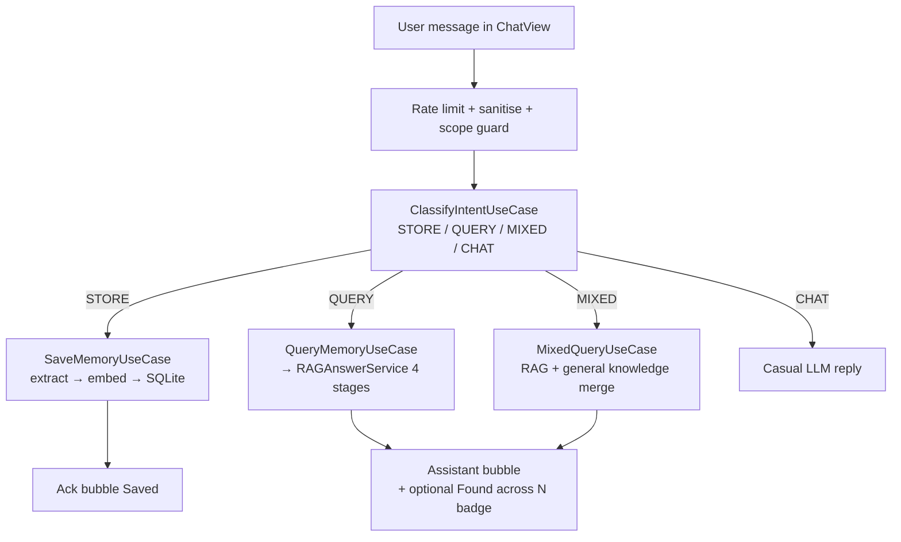

# How RAG Works in Mind Mapper

Plain-language theory of **Retrieval-Augmented Generation**, plus how this app implements it end-to-end — from saving a fact in chat to answering “Where is my passport?” weeks later.

**Related code:** `Core/RAG/`, `Core/VectorStore/VectorStore.swift`, `Domain/UseCases/{Save,Query,Mixed}Memory*.swift`, `Features/Chat/ChatViewModel.swift`  
**Related tasks:** [`10`](../tasks/phase_1/10-intent-classifier_iOS.md)–[`14`](../tasks/phase_1/14-mixed-query-chat_iOS.md) (intent → save → retrieve → synthesise → orchestrate); [`19c`](../tasks/phase_1/19c-chat-rolling-transcript_iOS.md) (rolling chat window shared with STORE/CHAT)  
**Related flow:** [`app-flow.md`](../design/app-flow.md) (Chat is where RAG runs; Memories tab is still a list UI)  
**Also see:** [`embedding-blob-6144-bytes.md`](./embedding-blob-6144-bytes.md), [`llm-temperature.md`](./llm-temperature.md), [`chat-session-message-context.md`](./chat-session-message-context.md)

---

## The short answer

A normal chat model only knows what you put in the prompt (plus its training). It **cannot** see your SQLite memories unless we fetch them first.

**RAG** = **R**etrieve useful memories → **A**ugment the prompt with them → **G**enerate an answer from that grounded context.

| Without RAG | With RAG (Mind Mapper) |
|---|---|
| “Where’s my passport?” → model guesses or says it doesn’t know | Embed the question → find nearby memory vectors + entity hits → feed those facts into the LLM → answer from *your* data |

Mind Mapper stores memories **on device** (GRDB). Embeddings and chat completions go through Supabase Edge Functions (`LLMClient`). Retrieval math (cosine similarity) runs **locally**.

---

## Theory in plain language

### 1. What problem does RAG solve?

LLMs are great at language, bad at *your* private facts:

- They were never trained on “passport is in the safe.”
- You cannot stuff every past chat into every prompt (cost, limits, noise).
- Keyword search fails on paraphrase (“navy tee” vs “blue T-shirt”).

So we keep a **memory library** (text + vectors). At ask-time we **look up** the few relevant rows, then ask the model to write a reply **only from those rows**.

### 2. Embeddings = meaning as numbers

An embedding model turns a sentence into a fixed list of floats (here **1,536** → **6,144 bytes** on disk). Similar meanings land near each other in that space.

```text
"Blue T-shirt is in the 3rd drawer"  →  [0.12, -0.04, …]  (1,536 numbers)
"Where is my navy tee?"              →  [0.11, -0.03, …]  (nearby → high cosine similarity)
```

Cosine similarity ≈ “how aligned are these two directions?” Score near **1** = very similar; near **0** = unrelated. See [`embedding-blob-6144-bytes.md`](./embedding-blob-6144-bytes.md).

### 3. Hybrid retrieval (why not vectors alone?)

| Path | Good at | Weak at |
|---|---|---|
| **Vector search** | Paraphrase, synonyms, fuzzy recall | Exact names that embed poorly |
| **Entity SQL (`LIKE`)** | Exact nouns (“wife”, “passport”) | Wording that never got tagged |

Mind Mapper runs **both**, merges by `memoryId`, then filters weak vector hits.

### 4. Generation must stay grounded

Stage 4 tells the model: answer **only** from provided memories; mark outdated facts; use rough dates. That is the “augmented” part of RAG — without it, retrieval is useless and the model may invent.

### 5. Save time vs query time

RAG needs **two** pipelines:

```text
STORE (save time)     extract clean fact → embed → write memories + vectors (+ entities)
QUERY (ask time)      embed question → retrieve → filter → temporal order → synthesise
```

If you never save embeddings, query-time search has nothing to compare.

---

## Where it sits in the app

From [`app-flow.md`](../design/app-flow.md): signed-in users open **Chats** → `ChatSessionListView` → `ChatView`. Sending a message runs guards → **intent** → one of the pipelines below. The Memories tab lists stored facts later (task 22); **RAG itself runs on send** inside chat.



---

## Intent routing (doorway into RAG)

Before any retrieval, chat classifies the message.

```22:37:iOSApp/MindMapper/MindMapper/Domain/UseCases/ClassifyIntentUseCase.swift
        let systemPrompt = """
            Classify this personal memory app message. Reply with exactly one word.

            STORE — user is sharing a fact, decision, or personal note
            ("I put my passport in the drawer", "We decided on Bali", "I keep my keys on the shelf")

            QUERY — user is asking about something previously stored
            ("Where is my passport?", "What did we decide about the trip?", "Let me know about the trip details")

            MIXED — user asks something needing both stored memory AND general knowledge
            ("What dress ideas did we discuss, and can you suggest more options?")

            CHAT — casual talk, no fact to store or find
            ("Thanks!", "That's helpful", "Good morning")
```

`ChatViewModel` then routes:

```449:472:iOSApp/MindMapper/MindMapper/Features/Chat/ChatViewModel.swift
    private func route(intent: Intent, text: String) async throws -> String {
        switch intent {
        case .store:
            return try await dependencies.saveMemoryUseCase.execute(
                text: text,
                sessionId: sessionId,
                userId: userId
            )
        case .query:
            let answer = try await dependencies.queryMemoryUseCase.execute(
                question: text,
                sessionId: sessionId,
                userId: userId
            )
            lastAnswerSessionCount = answer.representedSessionIds.count
            return answer.text
        case .mixed:
            let answer = try await dependencies.mixedQueryUseCase.execute(
                question: text,
                sessionId: sessionId,
                userId: userId
            )
            lastAnswerSessionCount = answer.representedSessionIds.count
            return answer.text
```

Cross-session badge when `lastAnswerSessionCount > 1` → `L10n.Chat.foundAcross` in `ChatView`.

---

## Save time — indexing for future RAG

Task [`11-memory-save-pipeline_iOS.md`](../tasks/phase_1/11-memory-save-pipeline_iOS.md).

**Steps:** extract clean fact + entities → optional supersede lookup → embed `cleanText` → write memory/entities → write vector → warm ack.

```26:52:iOSApp/MindMapper/MindMapper/Domain/UseCases/SaveMemoryUseCase.swift
    func execute(text: String, sessionId: String, userId: String) async throws -> String {
        let extraction = try await memoryExtractor.extract(from: text)
        let supersedesId = try await resolveSupersedesId(hint: extraction.supersedesHint)
        let embedding = try await llmClient.embed(text: extraction.cleanText, tier: .embed)

        let memory = Memory(
            sessionId: sessionId,
            userId: userId,
            rawText: text,
            cleanText: extraction.cleanText,
            supersedesId: supersedesId
        )
        // ...
        try await memoryRepository.save(
            memory,
            entities: entities,
            superseding: supersedesId
        )
        try await vectorRepository.save(embedding: embedding, memoryId: memory.id)
        return try await acknowledge(rawText: text)
    }
```

Extractor shape (`Core/RAG/MemoryExtractor.swift`):

```65:77:iOSApp/MindMapper/MindMapper/Core/RAG/MemoryExtractor.swift
        let systemPrompt = """
        You are a personal memory extraction assistant.
        Extract structured information from the user message.
        Reply ONLY with valid JSON, no other text. Keep the JSON compact.

        JSON format:
        {
          "clean_text": "normalised fact in standalone form",
          "entities": [
            { "type": "person|category|topic_id|product|location", "value": "the value" }
          ],
          "supersedes_hint": "word or phrase suggesting this replaces an older decision, or null"
        }
```

**Supersede example:** “Actually, a watch instead of the perfume” → hint embeds → vector search (threshold **0.80**) finds the old gift memory → new row links `supersedes_id`, old row `is_superseded = true`. Query-time Stage 3 can still *read* superseded rows to explain history.

Local similarity lives in `VectorStore`:

```67:81:iOSApp/MindMapper/MindMapper/Core/VectorStore/VectorStore.swift
    static func cosineSimilarity(_ a: [Float], _ b: [Float]) -> Float {
        guard a.count == b.count, !a.isEmpty else { return 0 }
        var dot: Float = 0
        var magA: Float = 0
        var magB: Float = 0
        for index in a.indices {
            let av = a[index]
            let bv = b[index]
            dot += av * bv
            magA += av * av
            magB += bv * bv
        }
        let denominator = sqrt(magA) * sqrt(magB)
        guard denominator > 0 else { return 0 }
        return dot / denominator
    }
```

---

## Query time — four-stage RAG pipeline

Tasks [`12-rag-retrieval_iOS.md`](../tasks/phase_1/12-rag-retrieval_iOS.md) + [`13-rag-synthesis_iOS.md`](../tasks/phase_1/13-rag-synthesis_iOS.md).

Thin domain wrapper:

```19:28:iOSApp/MindMapper/MindMapper/Domain/UseCases/QueryMemoryUseCase.swift
    func execute(
        question: String,
        sessionId: String,
        userId: String
    ) async throws -> RAGAnswer {
        try await answerService.answer(
            question: question,
            sessionId: sessionId,
            userId: userId
        )
    }
```

Orchestration of all four stages:

```34:56:iOSApp/MindMapper/MindMapper/Core/RAG/RAGAnswerService.swift
    func answer(
        question: String,
        sessionId: String,
        userId: String
    ) async throws -> RAGAnswer {
        let raw = try await retriever.retrieve(question: question, userId: userId)
        let confident = RAGRetriever.filterConfident(raw)
        let sessionIds = RetrievedChunk.representedSessionIds(in: confident)

        if confident.isEmpty {
            let text = try await noMemoryReply(question: question)
            return RAGAnswer(text: text, representedSessionIds: [])
        }

        let resolved = RAGRetriever.resolveTemporalOrder(confident)
        let recentMessages = try await loadRecentMessages(sessionId: sessionId)
        let text = try await synthesise(
            question: question,
            memories: resolved,
            recentMessages: recentMessages
        )
        return RAGAnswer(text: text, representedSessionIds: sessionIds)
    }
```

### Stage 1 — Hybrid retrieve (`RAGRetriever.retrieve`)

Broad net: embed question + extract up to 4 nouns in parallel; then vector search (**topK 15**, threshold **0.55**, `includeSuperseded: true`) + entity `LIKE` search; merge/dedupe.

```50:69:iOSApp/MindMapper/MindMapper/Core/RAG/RAGRetriever.swift
    func retrieve(question: String, userId: String) async throws -> [RetrievedChunk] {
        async let embeddingTask = llmClient.embed(text: question, tier: .embed)
        async let entityHintsTask = extractEntitiesFromQuestion(question)

        let queryEmbedding = try await embeddingTask
        let entityHints = await entityHintsTask

        async let vectorTask = vectorStore.search(
            queryEmbedding: queryEmbedding,
            topK: Self.vectorTopK,
            threshold: Self.vectorThreshold,
            userId: userId,
            includeSuperseded: true
        )
        async let entityTask = searchByEntities(hints: entityHints, userId: userId)

        let vectorChunks = try await vectorTask.map(Self.chunk(fromVector:))
        let entityChunks = try await entityTask
        return Self.merge(vectorChunks + entityChunks)
    }
```

Each hit is a `RetrievedChunk` (`memoryId`, `cleanText`, `similarity`, `source` = `"vector"` | `"entity"`, session + supersede fields).

### Stage 2 — Confidence filter

Keep `similarity >= 0.62`, **or** any entity match (exact SQL hits bypass the bar).

```74:80:iOSApp/MindMapper/MindMapper/Core/RAG/RAGRetriever.swift
    static func filterConfident(
        _ chunks: [RetrievedChunk],
        threshold: Float = RAGRetriever.defaultConfidenceThreshold
    ) -> [RetrievedChunk] {
        chunks.filter { $0.similarity >= threshold || $0.source == "entity" }
    }
```

Empty after this → warm “I don’t have anything stored about that” via `.mini` (no invented facts).

### Stage 3 — Temporal resolution

Sort oldest → newest. If memory B supersedes A, annotate A’s text for the prompt only (SQLite unchanged here):

```85:107:iOSApp/MindMapper/MindMapper/Core/RAG/RAGRetriever.swift
    static func resolveTemporalOrder(_ chunks: [RetrievedChunk]) -> [RetrievedChunk] {
        let sorted = chunks.sorted { $0.createdAt < $1.createdAt }

        var supersededBy: [String: String] = [:]
        for chunk in sorted {
            if let oldId = chunk.supersedesId {
                supersededBy[oldId] = chunk.cleanText
            }
        }

        return sorted.map { chunk in
            guard let newText = supersededBy[chunk.memoryId] else { return chunk }
            return RetrievedChunk(
                memoryId: chunk.memoryId,
                cleanText: "[OUTDATED → replaced by: \(newText)] \(chunk.cleanText)",
                // ...
```

So “passport was in the drawer, then moved to the safe” can be answered with history, not only the latest line.

### Stage 4 — LLM synthesis

System prompt + numbered memories `[1] [Mar 3] …` + last **12** session messages (`ChatLimits.rollingContextMessageCount`, shared with STORE/CHAT) + the question → `tier: .mini`, `temperature: 0.4`.

Rolling chat here is **short-term glue** inside the current session. Long-term facts still come from retrieved memories (Stages 1–3). See [`chat-session-message-context.md`](./chat-session-message-context.md).

```131:149:iOSApp/MindMapper/MindMapper/Core/RAG/RAGAnswerService.swift
    static let systemPrompt = """
    You are a personal memory assistant. Answer ONLY from the provided memories.
    Do not guess or add information not in the memories.

    If multiple memories show the same topic evolving over time:
    - Acknowledge the history ("You originally thought X...")
    - Clearly state what the current/latest decision is
    - If a memory is marked [OUTDATED], it was later replaced — mention it briefly

    If memories are from different time periods, say roughly when
    (e.g. "back in March", "more recently", "a few weeks ago").
    """

    /// Formats as `[1] [Mar 3] Blue T-shirt is in the 3rd drawer`.
    static func formatMemories(_ memories: [RetrievedChunk]) -> String {
        memories.enumerated().map { index, chunk in
            let date = memoryDateFormatter.string(from: chunk.createdAt)
            return "[\(index + 1)] [\(date)] \(chunk.cleanText)"
        }.joined(separator: "\n")
    }
```

---

## MIXED — RAG plus general knowledge

Task [`14-mixed-query-chat_iOS.md`](../tasks/phase_1/14-mixed-query-chat_iOS.md).

Same RAG path in parallel with a general `.full` call, then a `.mini` merge that **leads with personal memories**:

```21:43:iOSApp/MindMapper/MindMapper/Core/RAG/MixedQueryService.swift
        async let memoryTask = ragAnswerService.answer(
            question: question,
            sessionId: sessionId,
            userId: userId
        )
        async let generalTask = llmClient.complete(
            tier: .full,
            messages: [
                LLMMessage(
                    role: "system",
                    content: """
                    You are a knowledgeable assistant. Answer this question with general \
                    knowledge only. Be concise. Do not invent the user's personal facts.
                    """
                ),
                LLMMessage(role: "user", content: question),
            ],
            maxTokens: 300,
            temperature: 0.6
        )

        let memoryAnswer = try await memoryTask
        let general = try await generalTask
```

`representedSessionIds` still come from the memory branch (badge behaviour matches QUERY).

---

## DI wiring

Everything is constructed in `AppContainer` (no `.shared` RAG singletons inside use cases):

```132:149:iOSApp/MindMapper/MindMapper/Core/DI/AppContainer.swift
    func makeRAGRetriever() -> RAGRetriever {
        RAGRetriever(
            llmClient: LLMClient.shared,
            vectorStore: VectorStore(database: database),
            database: database
        )
    }

    func makeRAGAnswerService() -> RAGAnswerServiceProtocol {
        RAGAnswerService(
            retriever: makeRAGRetriever(),
            llmClient: LLMClient.shared,
            database: database
        )
    }

    func makeQueryMemoryUseCase() -> QueryMemoryUseCaseProtocol {
        QueryMemoryUseCase(answerService: makeRAGAnswerService())
    }
```

`makeChatDependencies()` injects save / query / mixed into `ChatViewModel`.

---

## Walkthrough: one question

User earlier stored (possibly across chats): passport in drawer, then “moved to the safe.”

1. **Ask:** “Where is my passport?”
2. **Intent:** `QUERY`
3. **Stage 1:** question embedding finds both memories; entity hint `"passport"` may hit `memory_entities` too
4. **Stage 2:** drop weak vector noise; keep strong / entity hits
5. **Stage 3:** older drawer fact annotated `[OUTDATED → replaced by: … safe …]`
6. **Stage 4:** model answers from that list — e.g. originally drawer, now safe
7. **UI:** assistant bubble; if chunks span 2+ sessions, “Found across N conversations”

---

## File map

| Piece | File |
|---|---|
| Intent | `Domain/UseCases/ClassifyIntentUseCase.swift` |
| Save / index | `Domain/UseCases/SaveMemoryUseCase.swift`, `Core/RAG/MemoryExtractor.swift` |
| Vectors | `Core/VectorStore/VectorStore.swift`, `Data/Repositories/VectorRepository.swift` |
| Stages 1–3 | `Core/RAG/RAGRetriever.swift` |
| Stage 4 + empty reply | `Core/RAG/RAGAnswerService.swift` |
| QUERY use case | `Domain/UseCases/QueryMemoryUseCase.swift` |
| MIXED | `Core/RAG/MixedQueryService.swift`, `Domain/UseCases/MixedQueryUseCase.swift` |
| Chat orchestration | `Features/Chat/ChatViewModel.swift` |
| Factories | `Core/DI/AppContainer.swift` |
| Tests | `MindMapperTests/RAGRetrieverTests.swift`, `RAGAnswerServiceTests.swift`, `SaveMemoryUseCaseTests.swift`, … |

---

## Mental checklist

- **RAG ≠ the chat model alone** — retrieval must run first.
- **Save pipeline builds the index**; query pipeline **reads** it.
- **Hybrid** = meaning (vectors) + exact nouns (entities).
- **Filter** before synthesis so Stage 4 is not drowned in weak matches.
- **Temporal / supersede** keeps answers honest when facts change.
- **Grounded prompt** (“only from provided memories”) is what stops hallucination on personal data.
