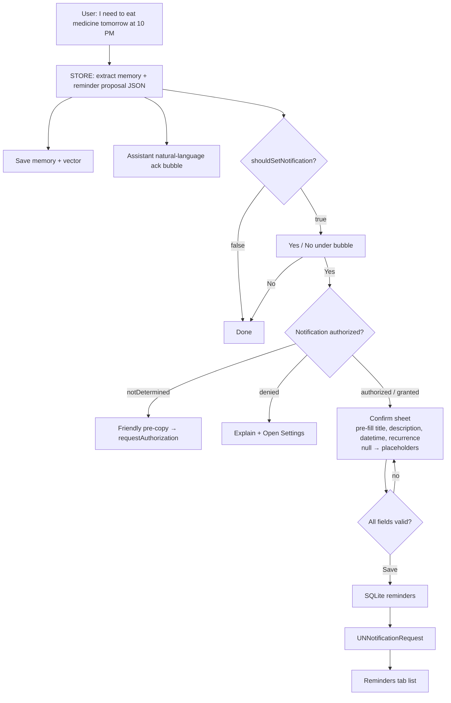

# Local Reminders & Notifications

---

## Category
`ios`

## Estimated Time
⏱️ 6–9 hours

## Depends On
Task 11 (STORE / `MemoryExtractor`), Task 14 (`ChatViewModel`), Task 18 (`ChatView`), Task 19c (rolling transcript), Task 06 (GRDB migrations)

## Related Plan Section
📄 `../planning/execution-plan.md` → **Phase 14 — Notifications & Reminders** (implement via this task; prefer DI over `.shared` sketches)  
📄 `iOSApp/AGENT.md` › MVVM, DI, thin Views  
📄 `../design/app-flow.md` (tabs + notification tap → chat)

## Related UI
- Chat: after STORE reply, if LLM marks `shouldSetNotification=true` → **Yes / No** → **Confirm / editor sheet** (pre-filled, validated Save).
- **Reminders tab** (4th tab): list / edit / delete + manual **+**.
- Settings: notification permission status + “Open iOS Settings” if denied.
- System: `UNUserNotificationCenter` local notification (not remote push / FCM).

## Related learning
Add a short note in `docs/learning/` when shipping (local vs push; structured reminder proposal; permission timing).

---

## Locked product decisions *(confirmed)*

| # | Decision | Locked choice |
|---|---|---|
| A | Manage UI | **4th tab “Reminders”** + Settings permission row |
| B | Confirm UX | After LLM reply with `shouldSetNotification=true` → **Yes / No**, then **editor sheet** pre-filled from LLM (null → placeholders; Save blocked until all fields valid) |
| C | Recurrence | **`once` / `daily` / `weekly` / `monthly`** |
| D | Permission | **Only when user taps Yes** (never cold launch) |
| E | No clear datetime | Still set `shouldSetNotification=true` when remindable; send **`null`** for unclear fields; sheet shows placeholders — user must fill before Save |
| F | Manual create | **In** — toolbar **+** on Reminders tab (same editor, no `memory_id`) |

---

## Product goal

Examples:

- “I need to eat medicine tomorrow at 10 PM” → memory saved + proposal with title/time/`once` filled → Confirm UX.
- “I need to ask office HR about leave policy” → memory saved + `shouldSetNotification=true` but **`datetime` / maybe recurrence `null`** → Confirm UX with placeholders; user must set time (and any other missing fields) before Save.
- “Remind me every Monday at 9 to check leave balance” → proposal with `weekly` when LLM can infer it.

App flow:

1. **STORE** fact (existing pipeline).
2. LLM returns a **structured reminder proposal** alongside the normal ack (see schema below) — **do not** schedule yet.
3. If `shouldSetNotification == true` → show **Yes / No** under the assistant reply.
4. **Yes** → permission (if needed) → **editor sheet** pre-filled from proposal → user edits → **Save** only if all fields valid → SQLite + `UNUserNotificationCenter`.
5. **No** → dismiss offer; memory remains.
6. Reminders tab: list / edit / delete / **+** manual.
7. Notification tap → open related chat/session when linked.

```text
iOS App
  │
  └── LocalNotificationService (DI)
          │
          ▼
     UNUserNotificationCenter
          │
          ▼
     iOS schedules it
          │
          ▼
     Future date/time
          │
          ▼
    🔔 Banner / lock screen
          │ (user taps)
          ▼
     AppRouter → chat / memory
```



---

## LLM structured reminder proposal

**Visible chat bubble** stays a warm natural ack (existing STORE behaviour).  
**Machine fields** come from the same STORE extraction (or a dedicated decode step) — **not** by showing raw JSON to the user.

Extend `ExtractionResult` / extractor JSON (names may be camelCase in Swift, snake in JSON):

```json
{
  "clean_text": "User needs to take medicine tomorrow at 10 PM",
  "entities": [ ... ],
  "supersedes_hint": null,
  "should_set_notification": true,
  "notification_title": "Take medicine",
  "notification_description": "Time to take your medicine",
  "notification_datetime": "2026-08-15T22:00:00+07:00",
  "notification_recurrence": "once"
}
```

| Field | Type | Rules |
|---|---|---|
| `should_set_notification` | `Bool` | `true` when the message is remindable (explicit “remind me” **or** actionable future follow-up like medicine / ask HR / deadline). |
| `notification_title` | `String?` | Short title; `null` if unclear → sheet placeholder. |
| `notification_description` | `String?` | Body; `null` → placeholder. |
| `notification_datetime` | `String?` | ISO-8601 with offset or local wall time documented in Notes; **`null` if no clear time** (e.g. “ask HR about leave”). |
| `notification_recurrence` | `String?` | `once` \| `daily` \| `weekly` \| `monthly`; **`null` if unclear** (default UI suggestion can be `once` only as a soft default in the picker — still require explicit user selection before Save if LLM sent null). |

Examples:

| User message | `should_set_notification` | datetime | recurrence |
|---|---|---|---|
| Medicine tomorrow 10 PM | `true` | filled | `once` (or null → user picks) |
| Ask HR about leave | `true` | **`null`** | **`null`** or `once` |
| Casual “thanks” | `false` | omit / null | omit / null |

**Never schedule** from extraction alone — only after Confirm sheet Save with validated fields.

---

## Architecture rules (hard)

- **Local only** — `UserNotifications`. No APNs / FCM / Supabase push in 19d.
- **No `.shared`** in ViewModels / use cases — inject `LocalNotificationServiceProtocol` via `AppContainer`.
- Views thin; schedule/cancel in service + use cases.
- Theme tokens + `L10n`; compose existing components.
- Migration id **`v3_reminders`** (`v2_session_pin` already shipped).

---

## Data model

### SQLite `reminders` (migration `v3_reminders`)

| Column | Type | Notes |
|---|---|---|
| `id` | TEXT PK | UUID |
| `user_id` | TEXT NOT NULL | Owner |
| `memory_id` | TEXT NULL | FK → `memories` when from chat STORE |
| `session_id` | TEXT NULL | Tap → open chat |
| `title` | TEXT NOT NULL | |
| `body` | TEXT NOT NULL | Description |
| `fire_at` | DATETIME NOT NULL | First / next fire |
| `recurrence` | TEXT NOT NULL | `once` \| `daily` \| `weekly` \| `monthly` |
| `notification_id` | TEXT NOT NULL | `UNNotificationRequest` id |
| `is_enabled` | BOOL NOT NULL | Soft disable |
| `created_at` / `updated_at` | DATETIME | |

Domain: `Reminder` + `ReminderRecurrence` (`once`, `daily`, `weekly`, `monthly`).  
Repository: `ReminderRepositoryProtocol` / impl.  
On memory/session delete: **cancel UN request + delete** linked reminders (prefer over orphaning).

---

## UI specification

### 1) Chat — after LLM reply

When STORE completes and proposal.`shouldSetNotification == true`:

1. Show normal assistant **ack** bubble (human text).
2. Under it: **Yes** / **No** (“Set a reminder?”).
3. **No** → clear `pendingReminderOffer`; no permission prompt.
4. **Yes** → permission flow → present **ReminderConfirmSheet**.

State on `ChatViewModel`: `pendingReminderOffer: ReminderOfferDisplayModel?` (title/description/datetime/recurrence optionals from LLM).

### 2) Confirm / editor sheet (chat Yes **and** tab + / edit)

Pre-fill from LLM proposal:

| Field | LLM value present | LLM `null` |
|---|---|---|
| Title | Pre-filled | Placeholder e.g. “Reminder title” |
| Description | Pre-filled | Placeholder e.g. “What should the notification say?” |
| Date & time | Pre-filled `DatePicker` | Placeholder / empty state — user must pick (`DatePicker` required) |
| Recurrence | Pre-selected | Placeholder “Choose frequency” — user must pick `once` / `daily` / `weekly` / `monthly` |

**Save** enabled only when:

- Title non-empty (trimmed)
- Description non-empty (trimmed)
- Datetime selected and **> now** (small skew OK, e.g. ≥ 1 minute ahead)
- Recurrence explicitly selected (including `once`)

Invalid Save → inline field errors (`ThemeBadge` / caption), do not dismiss.

Cancel → dismiss without scheduling; offer may clear or remain until No — **clear pending offer on Cancel** (document in As shipped).

### 3) Reminders tab *(locked)*

```
TabView: Chats | Memories | Reminders | Settings
```

- Large title “Reminders”
- Upcoming / Past (or one list by `fire_at`)
- Row: title, time, recurrence capsule
- Swipe delete → cancel UN + delete row
- Tap → same editor (edit + reschedule)
- Empty state copy
- **Toolbar +** → blank editor (all placeholders; `memory_id` / `session_id` nil) — **in scope**

### 4) Settings — permission

- Status: Authorized / Denied / Not determined  
- Denied → “Open Settings”  
- Request only if `.notDetermined` (never spam after deny)

### 5) Permission timing

On first **Yes** while `.notDetermined`, optional pre-prompt then:

`requestAuthorization(options: [.alert, .sound, .badge])`.

Never on cold launch or on STORE alone.

---

## What To Do

### Domain + persistence

- [x] **1.** `Domain/Models/Reminder.swift` — `ReminderRecurrence`: `once`, `daily`, `weekly`, `monthly`.
- [x] **2.** Migration `v3_reminders` + `ReminderRecord` + `ReminderRepositoryProtocol` / impl.
- [x] **3.** Wire in `AppContainer`.

### Notification service

- [x] **4.** `Core/Notifications/LocalNotificationService.swift` (+ protocol): status, request, schedule, cancel, reschedule; calendar triggers for once/daily/weekly/monthly.
- [x] **5.** `UNUserNotificationCenter` delegate — foreground presentation + tap → `.openMemory` / `.openReminder` with `session_id` / `memory_id` / `reminder_id`.

### Extraction + chat Confirm UX

- [x] **6.** Extend `MemoryExtractor` / `ExtractionResult` with `shouldSetNotification` + notification title / description / datetime / recurrence (`null` allowed). Update prompt with examples (medicine @ 10 PM vs ask HR with null datetime).
- [x] **7.** `SaveMemoryUseCase` (or STORE result type) returns ack text **+** `ReminderProposal?`. **Never** schedule inside save.
- [x] **8.** `ChatViewModel` / `ChatView`: Yes/No under ack when proposal flag true; Yes → permission → sheet; wire `ScheduleReminderUseCase` / update / delete.
- [x] **9.** Sheet ViewModel: `canSave` validation; map ISO datetime with device `Calendar` / time zone; reject past dates.

### Reminders tab + Settings

- [x] **10.** `AppRouter.Tab.reminders` + `RootView` + `L10n`.
- [x] **11.** `Features/Reminders/*` list + VM + row model + **+** create; `AppContainer` factory.
- [x] **12.** Settings notification status section.
- [x] **13.** Update `app-flow.md`, `AGENT.md` tree/factories when shipping.

### Tests & docs

- [x] **14.** Unit tests: proposal decode (null fields); `canSave` matrix; repo CRUD; notification service spy; Yes does not schedule until Save; delete cancels id; monthly/weekly trigger builders.
- [ ] **15.** Manual: medicine +1 min; ask HR (null time → must pick); edit; delete; deny permission; tap notification → chat; manual **+**.
- [x] **16.** Mark this task As shipped; Phase 14 pointer; learning note optional.

---

## ✅ Done When

- [x] Medicine tomorrow 10 PM → ack + Yes/No → sheet pre-filled → Save → pending local notification + Reminders tab row. *(unit-covered; manual still on item 15)*
- [x] Ask HR (no time) → `shouldSetNotification=true`, datetime null → sheet placeholders → Save disabled until time (and all fields) set.
- [x] Recurrence supports **once / daily / weekly / monthly**.
- [x] Manual **+** creates a reminder without chat.
- [x] No permission prompt on cold launch or STORE without Yes.
- [x] Edit/delete reschedules or cancels UN requests.
- [x] Tap notification opens related session when linked.
- [x] Thin Views; DI; theme / `L10n`; tests pass.

---

## As shipped

- Migration **`v3_reminders`**. Domain `Reminder` / `ReminderProposal` / `SaveMemoryResult`. STORE never schedules.
- Confirm UX: Yes/No under ack → permission on Yes only → `ReminderEditorView` sheet (shared with tab + / edit). **Cancel and Save both clear `pendingReminderOffer`.**
- Tabs: Chats | Memories | **Reminders** | Settings. Notification tap with `session_id`/`memory_id` → chat; otherwise Reminders tab.
- Learning: `docs/learning/local-reminders-notifications.md`.

---

## 📝 Notes

**Out of scope**

- Remote push / APNs / FCM.
- Custom weekdays RRULE, snooze UI, Critical Alerts.
- Auto-schedule without Confirm UX.
- Proactive “birthday in 3 days” without user offer (old Phase 14 Type 2).

**Recurrence → `UNCalendarNotificationTrigger`**

| Mode | Trigger |
|---|---|
| `once` | Date components at `fire_at`, `repeats: false` |
| `daily` | Hour + minute, `repeats: true` |
| `weekly` | Weekday + hour + minute, `repeats: true` |
| `monthly` | Day-of-month + hour + minute, `repeats: true` (document edge cases e.g. day 31) |

**Relation to Phase 14 sketches**

Old plan used `NotificationManager.shared` and auto-schedule on extract. **19d supersedes:** DI, structured proposal + Confirm UX, Reminders tab + manual +, `v3_reminders`.

**Already shipped (reuse)**

- `.openMemory` on `RootView`; STORE / extract / chat; Settings shell; `AppRouter.Tab`.
